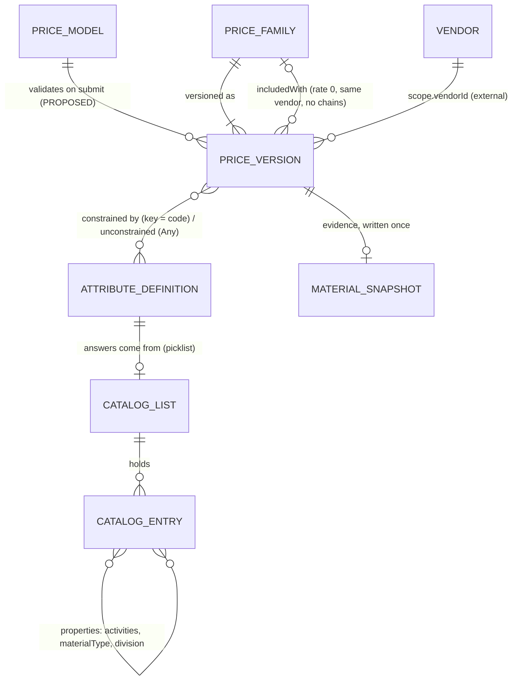

# Vendor Price Catalog: overview

What the model is, in one page. The detail is in [SOURCE.md](SOURCE.md); how it lines up with
Silverston is in [COMPARISON.md](COMPARISON.md).

## The problem it solves
Many vendors price field work (hauling, disposal, chemicals, rentals, labour) in their own
words. Field apps record the work, and someone has to find **the one approved price** for it and
show why it applied. The model gives vendors, field apps and the buyer's staff one shared
vocabulary for "what a price depends on".

## Three tables, six logical things
Three physical tables, but the JSONB parts hide more entities than that:

| Logical thing | Lives in | Says |
|---|---|---|
| **Attribute** | `attribute_definitions` | A question a price can answer: material? truck type? area? |
| **Catalog list + entry** | `picklist_values` (`listKey` = the list) | The allowed answers, each with a UUID, a stable code and typed `properties` |
| **Price version** | `vendor_price` | One vendor's rate for one combination of answers, in a scope, for a period |
| **Price family** | `vendor_price.family_id` | All versions of "the same price" |
| **Answers on a price** | `price_constraints` + `unconstrained_keys` | Specific value, Any, Any of a type, or blank (not answered) |
| **Price model** (PROPOSED) | `picklist_values`, list `price_models` | A template: which questions a kind of price must answer, what's fixed, where Any is allowed |

## How it flows
1. **The catalog defines the vocabulary.** Attributes are the questions; lists hold the answers.
   It's flat: activity, material, truck type and area are independent answers a price combines,
   with no product hierarchy. An activity's `priceAttributes` says which questions apply to it
   (haul → material, truck type, area, department).
2. **A vendor drafts a price** for one combination: specific values in `price_constraints`, the
   keys it doesn't care about in `unconstrained_keys`, "any water" as `materialType: water`.
   Blank keys are fine in a draft and block submit.
3. **Scope and dates narrow it:** vendor (and location), divisions, departments, areas, effective
   from/to.
4. **The buyer approves it.** draft → submitted → approved or rejected. A newer approved version
   in the same family supersedes the old one. Nothing is deleted; old rows are archived.
5. **Bundles and add-ons link prices:** a $0 price `includedWith` the one that covers it; an
   `add_on` activity attaches to a main charge.
6. **Field apps use it** to describe work, find the approved price, calculate the charge and keep
   the evidence. Selecting that one price (specificity, ambiguity) is not designed yet, and who
   owns steps 2 to 4 is open.

## The ideas that carry it
- **Questions as data:** a new pricing question is a row, not a migration.
- **A price is a whole rate for a combination**, not a sum of parts (the big difference from
  Silverston, COMPARISON §3.1).
- **Any ≠ blank:** "doesn't matter" is an answer; "not answered" isn't.
- **Meaning never changes under a code**, and the price keeps a snapshot anyway.
- **Released prices never get rewritten:** any change is a new draft version.
