# Vol 1, Chapter 3 — ER diagram

The diagram shows what `schema.sql` implements, not the book's figures.
GOOD and SERVICE are values of `product.product_kind`; GOOD also has a subtype table (`good`),
added in Fig 3.3 because only goods carry identification codes.
Every table has a single-column key and plain foreign keys.

```mermaid
erDiagram
  %% Fig 3.1 — Product definition
  PRODUCT {
    int  product_id PK
    text product_kind "GOOD or SERVICE"
  }

  %% Fig 3.2 — Product category
  PRODUCT                 ||--o{ PRODUCT_CATEGORY_CLASSIFICATION : "categorized by"
  PRODUCT_CATEGORY        ||--o{ PRODUCT_CATEGORY_CLASSIFICATION : "used to define"
  PRODUCT_CATEGORY_TYPE   ||--o{ PRODUCT_CATEGORY                : "dimension of"
  PRODUCT_CATEGORY        ||--o{ PRODUCT_CATEGORY_ROLLUP         : "made up of (parent)"
  PRODUCT_CATEGORY        ||--o{ PRODUCT_CATEGORY_ROLLUP         : "part of (child)"
  PRODUCT_CATEGORY        ||--o{ MARKET_INTEREST                 : "of interest to"
  PARTY_TYPE              ||--o{ MARKET_INTEREST                 : "interested in (Ch 2)"

  %% Fig 3.3 — Product identification
  PRODUCT                 ||--o| GOOD                            : "subtype (kind GOOD)"
  GOOD                    ||--o{ GOOD_IDENTIFICATION             : "identified by"
  IDENTIFICATION_TYPE     ||--o{ GOOD_IDENTIFICATION             : "used to define"

  %% Fig 3.4 — Product feature
  PRODUCT_FEATURE_TYPE               ||--o{ PRODUCT_FEATURE               : "kind of"
  PRODUCT_FEATURE_CATEGORY           |o--o{ PRODUCT_FEATURE               : "the category for"
  UNIT_OF_MEASURE                    |o--o{ PRODUCT_FEATURE               : "used in (DIMENSION only)"
  UNIT_OF_MEASURE                    |o--o{ PRODUCT                       : "used in"
  UNIT_OF_MEASURE                    ||--o{ UNIT_OF_MEASURE_CONVERSION    : "converted from"
  UNIT_OF_MEASURE                    ||--o{ UNIT_OF_MEASURE_CONVERSION    : "converted into"
  PRODUCT                            ||--o{ PRODUCT_FEATURE_APPLICABILITY : "available with"
  PRODUCT_FEATURE                    ||--o{ PRODUCT_FEATURE_APPLICABILITY : "used to define"
  PRODUCT_FEATURE_APPLICABILITY_TYPE ||--o{ PRODUCT_FEATURE_APPLICABILITY : "describes"
  PRODUCT_FEATURE                    ||--o{ PRODUCT_FEATURE_INTERACTION   : "selected in (of)"
  PRODUCT_FEATURE                    ||--o{ PRODUCT_FEATURE_INTERACTION   : "a factor in"
  PRODUCT                            |o--o{ PRODUCT_FEATURE_INTERACTION   : "context for"
  PRODUCT_FEATURE_INTERACTION_TYPE   ||--o{ PRODUCT_FEATURE_INTERACTION   : "describes"

  %% Fig 3.5 — Suppliers and manufacturers
  ORGANIZATION        |o--o{ PRODUCT           : "the producer of (Ch 2)"
  PRODUCT             ||--o{ SUPPLIER_PRODUCT  : "supplied thru"
  ORGANIZATION        ||--o{ SUPPLIER_PRODUCT  : "the supplier of"
  PREFERENCE_TYPE     |o--o{ SUPPLIER_PRODUCT  : "used to describe"
  RATING_TYPE         |o--o{ SUPPLIER_PRODUCT  : "the rating for"
  GOOD                ||--o{ REORDER_GUIDELINE : "subject to"
  GEOGRAPHIC_BOUNDARY |o--o{ REORDER_GUIDELINE : "the basis for (Ch 2)"
  FACILITY            |o--o{ REORDER_GUIDELINE : "the basis for (Ch 2)"
  ORGANIZATION        |o--o{ REORDER_GUIDELINE : "the basis for (internal org)"

  %% Fig 3.6 — Inventory items (facility XOR container: check constraint)
  GOOD                       ||--o{ INVENTORY_ITEM          : "the generic description for"
  INVENTORY_ITEM_STATUS_TYPE ||--o{ INVENTORY_ITEM          : "the state for"
  LOT                        |o--o{ INVENTORY_ITEM          : "made up of"
  FACILITY                   |o--o{ INVENTORY_ITEM          : "the location for"
  CONTAINER                  |o--o{ INVENTORY_ITEM          : "the storage container for"
  CONTAINER_TYPE             ||--o{ CONTAINER               : "the description of"
  FACILITY                   ||--o{ CONTAINER               : "the location of"
  INVENTORY_ITEM             ||--o{ INVENTORY_ITEM_VARIANCE : "adjusted thru"
  REASON                     ||--o{ INVENTORY_ITEM_VARIANCE : "the explanation for"
```

