# Vol 1, Chapter 4 — ER diagram

The diagram shows what `schema.sql` implements, not the book's figures. Fig 4.1 isn't built.
SALES and PURCHASE are values of `"order".order_kind`; each also has a subtype table
(`sales_order`, Fig 4.3; `purchase_order`, Fig 4.4). An item's kind is its order's; sales and
purchase items have subtype tables (`sales_order_item`, `purchase_order_item`). Every table has a single-column key and plain foreign keys.

```mermaid
erDiagram
  %% Fig 4.2 — Orders and order items
  ORDER {
    int  order_id PK
    text order_kind "SALES or PURCHASE"
    date order_date
  }
  ORDER                   ||--o{ ORDER_ITEM          : "composed of"
  PRODUCT                 ||--o{ ORDER_ITEM          : "ordered via (Ch 3)"
  PRODUCT_FEATURE         ||--o{ ORDER_ITEM          : "ordered via (Ch 3)"
  ORDER_ITEM              ||--o{ ORDER_ITEM          : "ordered with (features under their product)"
  ORDER_ITEM              ||--o| SALES_ORDER_ITEM    : "subtype (on a sales order)"

  %% Fig 4.3 — Sales order parties and contact mechanisms
  ORDER                   ||--o| SALES_ORDER         : "subtype (kind SALES)"
  PARTY_ROLE              ||--o{ SALES_ORDER         : "placer of / fulfiller of / bill-to (Ch 2)"
  CONTACT_MECHANISM       ||--o{ SALES_ORDER         : "placed using / taken via / billed to (Ch 2)"
  PARTY_ROLE              ||--o{ SALES_ORDER_ITEM    : "requested ship-to"
  CONTACT_MECHANISM       ||--o{ SALES_ORDER_ITEM    : "shipping location for"
  ORDER                   ||--o{ ORDER_ROLE          : "involving"
  PARTY                   ||--o{ ORDER_ROLE          : "involved in (Ch 2)"
  ORDER_ROLE_TYPE         ||--o{ ORDER_ROLE          : "description for"

  %% Fig 4.4 — Purchase order parties and contact mechanisms (4.3 turned over)
  ORDER                   ||--o| PURCHASE_ORDER      : "subtype (kind PURCHASE)"
  ORDER_ITEM              ||--o| PURCHASE_ORDER_ITEM : "subtype (on a purchase order)"
  PARTY_ROLE              ||--o{ PURCHASE_ORDER      : "placer of / fulfiller of / bill-to (Ch 2)"
  CONTACT_MECHANISM       ||--o{ PURCHASE_ORDER      : "placed using / taken via / billed to (Ch 2)"
  PARTY_ROLE              ||--o{ PURCHASE_ORDER_ITEM : "requested ship-to"
  CONTACT_MECHANISM       ||--o{ PURCHASE_ORDER_ITEM : "shipping location for"

  %% Fig 4.5 — Generic order roles and contact mechanisms (built beside 4.3 and 4.4)
  ORDER_ITEM              ||--o{ ORDER_ITEM_ROLE              : "involving"
  PARTY                   ||--o{ ORDER_ITEM_ROLE              : "involved in (Ch 2)"
  ORDER_ITEM_ROLE_TYPE    ||--o{ ORDER_ITEM_ROLE              : "description for"
  ORDER                   ||--o{ ORDER_CONTACT_MECHANISM      : "having"
  CONTACT_MECHANISM       ||--o{ ORDER_CONTACT_MECHANISM      : "used in (Ch 2)"
  CONTACT_MECHANISM_PURPOSE_TYPE ||--o{ ORDER_CONTACT_MECHANISM : "for (Ch 2)"
  ORDER_ITEM              ||--o{ ORDER_ITEM_CONTACT_MECHANISM : "having"
  CONTACT_MECHANISM       ||--o{ ORDER_ITEM_CONTACT_MECHANISM : "used in (Ch 2)"
  CONTACT_MECHANISM_PURPOSE_TYPE ||--o{ ORDER_ITEM_CONTACT_MECHANISM : "for (Ch 2)"

  %% Fig 4.6 — Order adjustments (for the order OR one item: a data-quality query)
  ORDER                   |o--o{ ORDER_ADJUSTMENT    : "affected by"
  ORDER_ITEM              |o--o{ ORDER_ADJUSTMENT    : "affected by"
  ORDER_ADJUSTMENT_TYPE   ||--o{ ORDER_ADJUSTMENT    : "description for"
  ORDER_ADJUSTMENT_TYPE   |o--o{ ORDER_ADJUSTMENT_TYPE : "parent of (the six subtypes on top)"
  GEOGRAPHIC_BOUNDARY     ||--o{ SALES_TAX_LOOKUP    : "taxed via (Ch 2)"
  PRODUCT_CATEGORY        |o--o{ SALES_TAX_LOOKUP    : "a consideration for (Ch 3)"

  %% Fig 4.7 — Order status and terms (each for the order OR one item: a data-quality query)
  ORDER                   |o--o{ ORDER_STATUS        : "in the state of"
  ORDER_ITEM              |o--o{ ORDER_STATUS        : "in the state of"
  STATUS_TYPE             ||--o{ ORDER_STATUS        : "description for (Ch 2, ORDER_STATUS group)"
  ORDER                   |o--o{ ORDER_TERM          : "subject to"
  ORDER_ITEM              |o--o{ ORDER_TERM          : "subject to"
  TERM_TYPE               ||--o{ ORDER_TERM          : "description for"

  %% Fig 4.8 — Order item association (a sales line filled by purchase lines; FKs on the subtype tables)
  SALES_ORDER_ITEM        ||--o{ ORDER_ITEM_ASSOCIATION : "associated with"
  PURCHASE_ORDER_ITEM     ||--o{ ORDER_ITEM_ASSOCIATION : "used to fulfill"

  %% Fig 4.9 — Requirements (origin CUSTOMER/INTERNAL and kind PRODUCT/WORK are columns on REQUIREMENT)
  REQUIREMENT             |o--o{ REQUIREMENT         : "composed of"
  FACILITY                |o--o{ REQUIREMENT         : "in need of (Ch 2)"
  REQUIREMENT             ||--o| PRODUCT_REQUIREMENT : "subtype (kind PRODUCT)"
  PRODUCT                 |o--o{ PRODUCT_REQUIREMENT : "asked for via (Ch 3)"
  PRODUCT_REQUIREMENT     ||--o{ DESIRED_FEATURE     : "specifying"
  PRODUCT_FEATURE         ||--o{ DESIRED_FEATURE     : "description for (Ch 3)"
  REQUIREMENT             ||--o{ REQUIREMENT_STATUS  : "in a state of"
  STATUS_TYPE             ||--o{ REQUIREMENT_STATUS  : "used to define (Ch 2, REQUIREMENT_STATUS group)"
  REQUIREMENT             ||--o{ REQUIREMENT_ROLE    : "associated with"
  PARTY                   ||--o{ REQUIREMENT_ROLE    : "assigned to (Ch 2)"
  REQUIREMENT_ROLE_TYPE   ||--o{ REQUIREMENT_ROLE    : "used to define"
  ORDER_ITEM              ||--o{ ORDER_REQUIREMENT_COMMITMENT : "the fulfiller of"
  REQUIREMENT             ||--o{ ORDER_REQUIREMENT_COMMITMENT : "committed by"

  %% Fig 4.10 — Requests (RFI, RFP, RFQ are request_type rows)
  REQUEST_TYPE            ||--o{ REQUEST             : "describes"
  REQUEST                 ||--o{ REQUEST_ITEM        : "composed of"
  REQUEST_ITEM            ||--o{ REQUIREMENT_REQUEST : "the method to communicate"
  REQUIREMENT             ||--o{ REQUIREMENT_REQUEST : "communicated via"
  REQUEST                 ||--o{ REQUEST_ROLE        : "involving"
  PARTY                   ||--o{ REQUEST_ROLE        : "involved in (Ch 2)"
  REQUEST_ROLE_TYPE       ||--o{ REQUEST_ROLE        : "description for"
  REQUEST                 ||--o{ RESPONDING_PARTY    : "submitted to"
  PARTY                   ||--o{ RESPONDING_PARTY    : "the recipient of (Ch 2)"
  CONTACT_MECHANISM       |o--o{ RESPONDING_PARTY    : "used to contact (Ch 2)"
```

