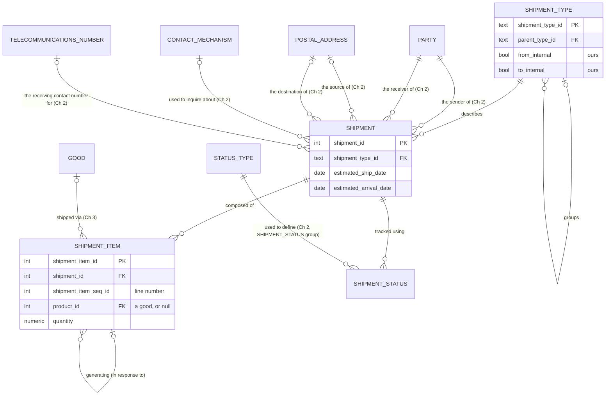

# Vol 1, Chapter 5 — ER diagram

The diagram shows what `schema.sql` implements, not the book's figures. The shipment subtypes
are rows of `shipment_type` (a hierarchy: OUTGOING and INCOMING over their pairs, TRANSFER and
DROP_SHIPMENT alone). Every table has a single-column key and plain foreign keys.

