# Vol 1, Chapter 6 — ER diagram

The diagram shows what `schema.sql` implements, not the book's figures. Ch 6 mostly extends
earlier tables (REQUIREMENT and REQUIREMENT ROLE from Ch 4, WORK EFFORT from Ch 2, FIXED ASSET
from Ch 5, ORDER ITEM from Ch 4); only the new columns are listed on them. Requirement types
are a hierarchy (PRODUCT_REQUIREMENT and WORK_REQUIREMENT over their leaves). Every table has
a single-column key and plain foreign keys.

```mermaid
erDiagram
  %% Fig 6.1 — Work requirement
  REQUIREMENT {
    int  requirement_id PK
    text requirement_kind "PRODUCT or WORK (Ch 4)"
    text requirement_type_id FK "new"
  }
  REQUIREMENT_TYPE {
    text requirement_type_id PK
    text parent_type_id FK
    text description
  }
  WORK_REQUIREMENT {
    int requirement_id PK, FK
    int product_id FK
    int fixed_asset_id FK
    int deliverable_id FK
  }
  DELIVERABLE {
    int  deliverable_id PK
    text deliverable_type_id FK
    text name
    text description
  }
  DELIVERABLE_TYPE {
    text deliverable_type_id PK
    text description
  }
  FIXED_ASSET {
    int     fixed_asset_id PK
    date    date_acquired "new"
    date    date_last_serviced "new"
    date    date_next_service "new"
    numeric production_capacity "new"
  }
  REQUIREMENT_TYPE |o--o{ REQUIREMENT      : "describes"
  REQUIREMENT_TYPE |o--o{ REQUIREMENT_TYPE : "groups"
  REQUIREMENT      ||--o| WORK_REQUIREMENT : "is a"
  PRODUCT          |o--o{ WORK_REQUIREMENT : "produced by (Ch 3)"
  FIXED_ASSET      |o--o{ WORK_REQUIREMENT : "worked on via"
  DELIVERABLE      |o--o{ WORK_REQUIREMENT : "produced by"
  DELIVERABLE_TYPE ||--o{ DELIVERABLE      : "defines"

  %% Fig 6.2 — Work requirement roles
  REQUIREMENT_ROLE {
    int  requirement_role_id PK
    int  requirement_id FK
    int  party_id FK
    text requirement_role_type_id FK
    date from_date
    date thru_date
    text comment "new"
  }
  REQUIREMENT           ||--o{ REQUIREMENT_ROLE : "involving (Ch 4)"
  PARTY                 ||--o{ REQUIREMENT_ROLE : "acting in (Ch 2)"
  REQUIREMENT_ROLE_TYPE ||--o{ REQUIREMENT_ROLE : "describes (Ch 4)"

  %% Fig 6.3a — Work effort generation
  WORK_EFFORT {
    int         work_effort_id PK
    text        work_effort_type_id FK "Ch 2"
    text        work_effort_purpose_type_id FK "new"
    int         facility_id FK "new"
    timestamptz actual_start_datetime "new"
    timestamptz actual_completion_datetime "new"
    numeric     actual_hours "new"
    text        special_terms "new"
  }
  WORK_EFFORT_TYPE {
    text    work_effort_type_id PK
    numeric standard_work_hours "new"
  }
  WORK_EFFORT_PURPOSE_TYPE {
    text work_effort_purpose_type_id PK
    text description
  }
  PRODUCTION_RUN {
    int     work_effort_id PK, FK
    numeric quantity_to_produce
    numeric quantity_produced
    numeric quantity_rejected
  }
  WORK_REQUIREMENT_FULFILLMENT {
    int work_requirement_fulfillment_id PK
    int work_effort_id FK
    int requirement_id FK
  }
  ORDER_ITEM {
    int  order_item_id PK
    text order_item_kind "PRODUCT or WORK, new"
  }
  WORK_ORDER_ITEM_FULFILLMENT {
    int work_order_item_fulfillment_id PK
    int work_effort_id FK
    int order_item_id FK
  }
  ORDER_REQUIREMENT_COMMITMENT {
    int     order_requirement_commitment_id PK
    int     order_item_id FK
    int     requirement_id FK
    numeric quantity
  }
  WORK_EFFORT_TYPE         ||--o{ WORK_EFFORT                  : "describes (Ch 2)"
  WORK_EFFORT_PURPOSE_TYPE |o--o{ WORK_EFFORT                  : "the purpose for"
  FACILITY                 |o--o{ WORK_EFFORT                  : "the location of (Ch 2)"
  WORK_EFFORT              ||--o| PRODUCTION_RUN               : "is a"
  WORK_EFFORT              ||--o{ WORK_REQUIREMENT_FULFILLMENT : "a fulfillment of"
  WORK_REQUIREMENT         ||--o{ WORK_REQUIREMENT_FULFILLMENT : "fulfilled by"
  WORK_EFFORT              ||--o{ WORK_ORDER_ITEM_FULFILLMENT  : "a fulfillment of"
  ORDER_ITEM               ||--o{ WORK_ORDER_ITEM_FULFILLMENT  : "fulfilled by (a WORK item)"
  ORDER_ITEM               ||--o{ ORDER_REQUIREMENT_COMMITMENT : "the fulfiller of (Ch 4)"
  REQUIREMENT              ||--o{ ORDER_REQUIREMENT_COMMITMENT : "committed by (Ch 4)"
```

