# Vol 1, Chapter 7 — ER diagram

The diagram shows what `schema.sql` implements, not the book's figures. Sales and purchase
invoices are an `invoice_kind` discriminator; invoice item types are a hierarchy
(ACQUIRING_ITEM and ADJUSTMENT over their leaves, 7.1b's two subtype sets). The billed-to arc
(a party or a billing account, exactly one) is a check constraint, and so are the invoice
term and payment application arcs. Payments and financial account transactions carry a
kind instead of subtype tables. Earlier chapters' tables
show only the columns Ch 7 touches. Every table has a single-column key and plain foreign
keys.

```mermaid
erDiagram
  %% Fig 7.1a — Invoice and invoice items
  INVOICE {
    int  invoice_id PK
    text invoice_kind "SALES or PURCHASE"
    date invoice_date
    text message
    text description
    int  billed_to_party_id FK "7.2; arc with billing_account_id"
    int  billed_from_party_id FK "7.2"
    int  addressed_to_contact_mechanism_id FK "7.2"
    int  sent_from_contact_mechanism_id FK "7.2"
    int  billing_account_id FK "7.3a"
  }
  INVOICE_ITEM_TYPE {
    text invoice_item_type_id PK
    text parent_type_id FK
    text description
  }
  INVOICE_ITEM {
    int     invoice_item_id PK
    int     invoice_id FK
    int     invoice_item_seq_id
    text    invoice_item_type_id FK
    int     product_id FK
    int     product_feature_id FK
    int     inventory_item_id FK
    int     adjustment_for_invoice_item_id FK
    int     sold_with_invoice_item_id FK
    boolean taxable_flag
    numeric quantity
    numeric amount
    text    item_description
  }
  PRODUCT { int product_id PK }
  PRODUCT_FEATURE { int product_feature_id PK }
  INVENTORY_ITEM { int inventory_item_id PK }

  INVOICE ||--o{ INVOICE_ITEM : "composed of"
  INVOICE_ITEM_TYPE ||--o{ INVOICE_ITEM : "the description for"
  INVOICE_ITEM_TYPE |o--o{ INVOICE_ITEM_TYPE : "parent of"
  PRODUCT |o--o{ INVOICE_ITEM : "billed via"
  PRODUCT_FEATURE |o--o{ INVOICE_ITEM : "billed via"
  INVENTORY_ITEM |o--o{ INVOICE_ITEM : "billed via"
  INVOICE_ITEM |o--o{ INVOICE_ITEM : "adjusted by"
  INVOICE_ITEM |o--o{ INVOICE_ITEM : "sold with"

  %% Fig 7.2 — Invoice parties
  PARTY { int party_id PK }
  CONTACT_MECHANISM { int contact_mechanism_id PK }
  INVOICE_ROLE_TYPE {
    text invoice_role_type_id PK
    text description
  }
  INVOICE_ROLE {
    int         invoice_role_id PK
    int         invoice_id FK
    int         party_id FK
    text        invoice_role_type_id FK
    timestamptz role_datetime
    numeric     percentage
  }

  PARTY |o--o{ INVOICE : "the receiver of"
  PARTY ||--o{ INVOICE : "the sender of"
  CONTACT_MECHANISM |o--o{ INVOICE : "used for billing"
  CONTACT_MECHANISM |o--o{ INVOICE : "used for sending"
  INVOICE ||--o{ INVOICE_ROLE : "involving"
  PARTY ||--o{ INVOICE_ROLE : "involved in"
  INVOICE_ROLE_TYPE ||--o{ INVOICE_ROLE : "the description of"

  %% Fig 7.3a — Billing account
  BILLING_ACCOUNT {
    int  billing_account_id PK
    date from_date
    date thru_date
    text description
    int  billed_at_contact_mechanism_id FK
  }
  BILLING_ACCOUNT_ROLE_TYPE {
    text billing_account_role_type_id PK
    text description
  }
  BILLING_ACCOUNT_ROLE {
    int  billing_account_role_id PK
    int  billing_account_id FK
    int  party_id FK
    text billing_account_role_type_id FK
    date from_date
    date thru_date
  }
  SALES_ORDER {
    int order_id PK "Ch 4"
    int bill_to_billing_account_id FK "new; arc with the bill-to role"
  }
  PURCHASE_ORDER {
    int order_id PK "Ch 4"
    int bill_to_billing_account_id FK "new; arc with the bill-to role"
  }

  BILLING_ACCOUNT |o--o{ INVOICE : "billed for"
  CONTACT_MECHANISM ||--o{ BILLING_ACCOUNT : "the billing mechanism for"
  BILLING_ACCOUNT ||--o{ BILLING_ACCOUNT_ROLE : "used by"
  PARTY ||--o{ BILLING_ACCOUNT_ROLE : "associated with"
  BILLING_ACCOUNT_ROLE_TYPE ||--o{ BILLING_ACCOUNT_ROLE : "the description of"
  BILLING_ACCOUNT |o--o{ SALES_ORDER : "requested bill to"
  BILLING_ACCOUNT |o--o{ PURCHASE_ORDER : "requested bill to"

  %% Fig 7.4 — Invoice status and terms
  INVOICE_STATUS {
    int  invoice_status_id PK
    int  invoice_id FK
    text status_type_id FK "Ch 2; INVOICE_STATUS group"
    date status_date
  }
  INVOICE_TERM {
    int     invoice_term_id PK
    text    term_type_id FK "Ch 4"
    int     invoice_id FK "arc"
    int     invoice_item_id FK "arc"
    numeric term_value
  }
  INVOICE ||--o{ INVOICE_STATUS : "in the state of"
  STATUS_TYPE ||--o{ INVOICE_STATUS : "the description for"
  INVOICE |o--o{ INVOICE_TERM : "subject to"
  INVOICE_ITEM |o--o{ INVOICE_TERM : "subject to"
  TERM_TYPE ||--o{ INVOICE_TERM : "the description for"

  %% Figs 7.5–7.7 — Billing for what was delivered
  SHIPMENT_ITEM_BILLING {
    int shipment_item_billing_id PK
    int shipment_item_id FK "Ch 5"
    int invoice_item_id FK
  }
  TIME_ENTRY_BILLING {
    int time_entry_billing_id PK
    int time_entry_id FK "Ch 6"
    int invoice_item_id FK
  }
  WORK_EFFORT_BILLING {
    int     work_effort_billing_id PK
    int     work_effort_id FK "Ch 6"
    int     invoice_item_id FK
    numeric percentage
  }
  ORDER_ITEM_BILLING {
    int     order_item_billing_id PK
    int     order_item_id FK "Ch 4"
    int     invoice_item_id FK
    numeric quantity
    numeric amount
  }
  SHIPMENT_ITEM ||--o{ SHIPMENT_ITEM_BILLING : "billed via"
  INVOICE_ITEM ||--o{ SHIPMENT_ITEM_BILLING : "the billing for"
  TIME_ENTRY ||--o{ TIME_ENTRY_BILLING : "billed via"
  INVOICE_ITEM ||--o{ TIME_ENTRY_BILLING : "the billing for"
  WORK_EFFORT ||--o{ WORK_EFFORT_BILLING : "billed via"
  INVOICE_ITEM ||--o{ WORK_EFFORT_BILLING : "the billing for"
  ORDER_ITEM ||--o{ ORDER_ITEM_BILLING : "billed via"
  INVOICE_ITEM ||--o{ ORDER_ITEM_BILLING : "the billing for"

  %% Fig 7.8a — Invoice payments
  PAYMENT_METHOD_TYPE {
    text payment_method_type_id PK
    text description
  }
  PAYMENT {
    int     payment_id PK
    text    payment_kind "RECEIPT or DISBURSEMENT"
    text    payment_method_type_id FK
    int     from_party_id FK
    int     to_party_id FK
    date    effective_date
    text    payment_ref_num
    numeric amount
    text    comment
    int     financial_account_transaction_id FK "7.9"
  }
  PAYMENT_APPLICATION {
    int     payment_application_id PK
    int     payment_id FK
    int     invoice_id FK "arc"
    int     billing_account_id FK "arc"
    numeric amount_applied
  }
  PAYMENT_METHOD_TYPE ||--o{ PAYMENT : "the method for paying"
  PARTY ||--o{ PAYMENT : "the payor of / the receiver of"
  PAYMENT ||--o{ PAYMENT_APPLICATION : "used to pay"
  INVOICE |o--o{ PAYMENT_APPLICATION : "paid via"
  BILLING_ACCOUNT |o--o{ PAYMENT_APPLICATION : "affected via"

  %% Fig 7.9 — Financial accounts
  FINANCIAL_ACCOUNT_TYPE {
    text financial_account_type_id PK
    text parent_type_id FK
    text description
  }
  FINANCIAL_ACCOUNT {
    bigint financial_account_id PK "the bank's number"
    text   financial_account_kind "BANK or INVESTMENT"
    text   financial_account_type_id FK
    text   financial_account_name
  }
  FINANCIAL_ACCOUNT_ROLE {
    int    financial_account_role_id PK
    bigint financial_account_id FK
    int    party_id FK
    text   financial_account_role_type_id FK
    date   from_date
    date   thru_date
  }
  FINANCIAL_ACCOUNT_TRANSACTION {
    int     financial_account_transaction_id PK
    text    transaction_kind "DEPOSIT, WITHDRAWAL or ADJUSTMENT"
    bigint  financial_account_id FK
    int     executed_by_party_id FK
    date    transaction_date
    date    entry_date
    numeric amount "adjustments only"
  }
  FINANCIAL_ACCOUNT_TYPE |o--o{ FINANCIAL_ACCOUNT : "the description for"
  FINANCIAL_ACCOUNT ||--o{ FINANCIAL_ACCOUNT_ROLE : "owned by"
  PARTY ||--o{ FINANCIAL_ACCOUNT_ROLE : "involved in"
  FINANCIAL_ACCOUNT ||--o{ FINANCIAL_ACCOUNT_TRANSACTION : "affected by"
  PARTY ||--o{ FINANCIAL_ACCOUNT_TRANSACTION : "the executer of"
  FINANCIAL_ACCOUNT_TRANSACTION |o--o{ PAYMENT : "deposited via / affecting"
```

