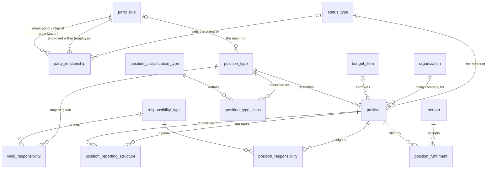

# Vol 1, Chapter 9 — ER diagram

Figs 9.2–9.6 (9.1 not built). Tables from earlier chapters are shown by name only.
Employment (9.2) is Ch 2's `party_relationship` typed EMPLOYMENT, read through the
`employment_relationship` view.

